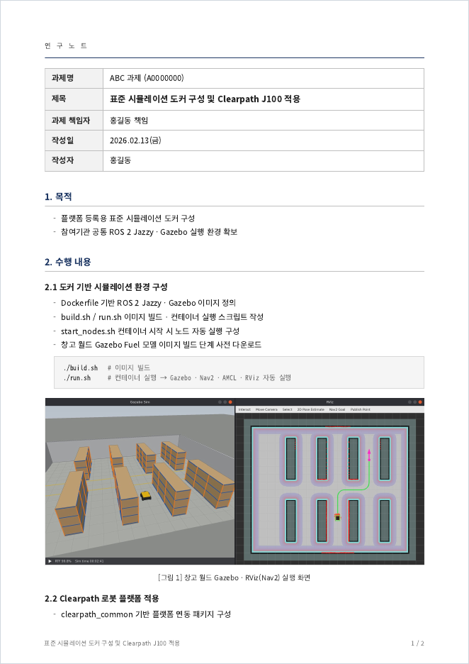
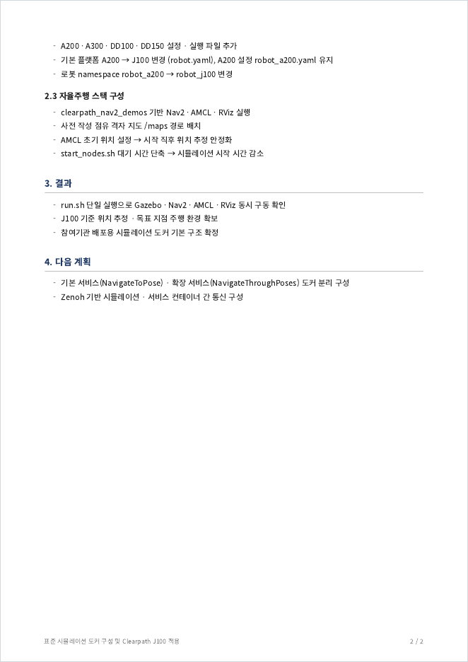

<div align="center">

# research-notes

**A Claude Code · Codex skill that turns repository commits into research note PDFs and copy-paste summaries for Korean government R&D projects (과제 연구노트)**

[](https://github.com/Neoplanetz/research-notes-skill/actions/workflows/tests.yml)
[](LICENSE)
[](SKILL.md)
[](SKILL.md)

[한국어](README.md) · **English**




</div>

## What it does

Korean government-funded R&D projects (과제) ask researchers to keep research notes (연구노트) on a fixed schedule. This skill reads the commits made during the note period, writes a research note PDF for each due date, and prepares the text you paste into your institute's research-note system.

- Due dates: two per month (2nd and 4th Friday; moved to the previous weekday on a public holiday)
- One A4 PDF per note (at most 4 pages, aiming for 1–2)
- Copy-paste text: 실험 제목 (experiment title) + a 7-line 실험내용요약 (experiment summary)
- Picks the important commits in the period, whatever their dates, and splits them into as many topics as there are notes
- Skips due dates you already have notes for, without repeating what they covered
- Shows a plan (date · title · source commits) and waits for your confirmation before writing

It never runs the repository's code, tests or apps. Content comes only from commits, README and docs, and images only from files already in the repositories or from you.

> **Language:** the skill replies in the language you write in. The notes, plan, PDF template and copy-paste text are always in Korean, because they follow the Korean research-note format.

## Install

Ask Claude Code or Codex to install it:

```text
Install this skill: https://github.com/Neoplanetz/research-notes-skill
```

With the [skills](https://github.com/vercel-labs/skills) CLI (Node.js 22.20 or later; it asks which tools to install to):

```bash
npx skills add Neoplanetz/research-notes-skill -g
```

It puts the files in `~/.agents/skills/research-notes` and links them for Claude Code. An existing `research-notes` install is overwritten.

<details>
<summary>Clone with git</summary>

Claude Code:

```bash
git clone https://github.com/Neoplanetz/research-notes-skill.git ~/.claude/skills/research-notes
```

Codex:

```bash
git clone https://github.com/Neoplanetz/research-notes-skill.git ~/.agents/skills/research-notes
```

For both, clone once and link the other location. Fresh install:

```bash
git clone https://github.com/Neoplanetz/research-notes-skill.git ~/.agents/skills/research-notes
mkdir -p ~/.claude/skills && ln -s ~/.agents/skills/research-notes ~/.claude/skills/research-notes
```

Already cloned for Claude Code? Just link it for Codex:

```bash
mkdir -p ~/.agents/skills && ln -s ~/.claude/skills/research-notes ~/.agents/skills/research-notes
```

</details>

Restart Claude Code or Codex after installing to pick up the skill.

### Update

- Installed with git: `git -C ~/.claude/skills/research-notes pull` (Codex: `~/.agents/skills/research-notes`)
- Installed with the skills CLI: `npx skills update`

## Usage

In a repository folder, call `/research-notes` in Claude Code or `$research-notes` in Codex, or just ask.

| Say | What happens |
|---|---|
| `/research-notes` | Asks for the project name first, then the rest. Values you entered before come back as choices |
| `Make this year's research notes from this repo's commits` | Uses the current repository and asks only for what is missing |
| `Write research notes for 2026.04~2026.12. My earlier notes are in ~/Downloads/notes` | Skips the dates already written and picks topics that don't overlap them |
| `Use only my commits from two repos (one URL, one local path)` | Collects only your commits from several repositories |

## How it works

1. **Inputs**: project name (with project number), short name (file name prefix), principal investigator, author, note period, folder of notes already written, repositories (current repo · URLs · local paths, several allowed), commit range and whose commits. Inputs are saved and offered as choices next time.
2. **Due dates**: counts public holidays and notes already written.
3. **Collect commits**
4. **Confirm the plan**: shows date · title · content · source commits first, and writes only after you confirm.
5. **Write → PDF → check**: checks the 7-line summary, the 4-page limit and the recommended length.
6. **Print the copy-paste text**

## Output

```
~/research-notes/<short name>/
  research-notes.json   inputs
  commits.txt           collected commits
  plan.md               confirmed plan
  notes/*.md            note sources (edit and re-render)
  notes/images/
  pdf/<prefix>_<YYMMDD>_<title>.pdf
  summary.txt           copy-paste text
```

`summary.txt` example:

```
[2026.02.13(금)] ABC_260213_표준_시뮬레이션_도커_구성_및_Clearpath_J100_적용.pdf
실험 제목
[ABC] 표준 시뮬레이션 도커 구성 및 Clearpath J100 적용 ('26, 2/13)

실험내용요약
- 플랫폼 등록용 표준 시뮬레이션 도커 구성
- ...(7 lines)
```

Re-render after editing one note (`summary.txt` is rebuilt from every note in the folder, and the old PDF is removed if the title changed). For a Codex install, replace `~/.claude/skills` with `~/.agents/skills`:

```bash
python3 ~/.claude/skills/research-notes/scripts/render.py ~/research-notes/ABC/notes/<file>.md \
  --pdf-dir ~/research-notes/ABC/pdf --summary ~/research-notes/ABC/summary.txt
```

## Requirements

- Claude Code or Codex
- Python 3.10 or later (no extra packages; with Pillow, large images are shrunk). On Windows without `python3`, run the commands below with `py -3` instead of `python3`
- Chrome, Chromium or Edge, version 131 or later (prints the PDF; older versions drop page numbers and the footer)
- A Korean font (Noto Sans CJK KR, Malgun Gothic, Apple SD Gothic Neo or NanumGothic)
- (Codex) `pdftotext` (poppler-utils) to read notes you already have as PDF
- OS: developed and checked on Linux. On macOS and Windows the tests (PDF rendering included) pass in CI, but a real note-writing run is not checked

## Using it in Codex

Codex runs commands in a sandbox. Inside it the PDF browser cannot start, and writing outside the working folder or using the network is blocked, so these steps ask for approval:

- Making PDFs (`render.py`) and saving inputs (`config.py save`): always
- Collecting commits (`collect.py`): when the output folder is outside the working folder or a repository is a URL
- Writing the plan and notes: when the output folder is outside the working folder

The approval prompt for a script also offers to stop asking for commands that start with `python3 …/scripts/<name>.py`. If you choose it, that script runs outside the sandbox from then on **with any arguments** (including where it writes files), without asking. Choose it only if you trust the repository content (commit messages, README).

Opening the output folder as writable from the start removes the approval prompts for writing the plan and notes. If the folder does not exist, every Codex command fails, so create it first:

```bash
mkdir -p ~/research-notes
codex --add-dir ~/research-notes
```

## Repository layout

```
SKILL.md               skill instructions the agent reads
agents/openai.yaml     name and description shown in Codex
scripts/               the scripts below (+ shared modules common.py · mdlite.py)
assets/                PDF template (HTML · CSS)
references/            writing rules, example note, example image
data/kr_holidays.json  Korean public holidays 2024–2030
tools/gen_holidays.py  regenerates the holiday table
tests/                 unit tests
```

| Script | What it does |
|---|---|
| `scripts/slots.py` | Period → due dates (`--existing` accounts for notes already written) |
| `scripts/collect.py` | Collects commits from several repositories (`--list-authors`, `--author`) |
| `scripts/render.py` | Note `.md` → PDF, checks, `summary.txt` |
| `scripts/config.py` | Saves inputs · profiles |

## Development

Tests (PDF rendering tests are skipped without a browser):

```bash
python3 -m unittest discover -s tests -v
```

Regenerate the holiday table (years outside it show "공휴일 확인 필요" (check holidays) in the plan):

```bash
pip install holidays
python3 tools/gen_holidays.py 2024 2035
```

## License

[MIT](LICENSE)
