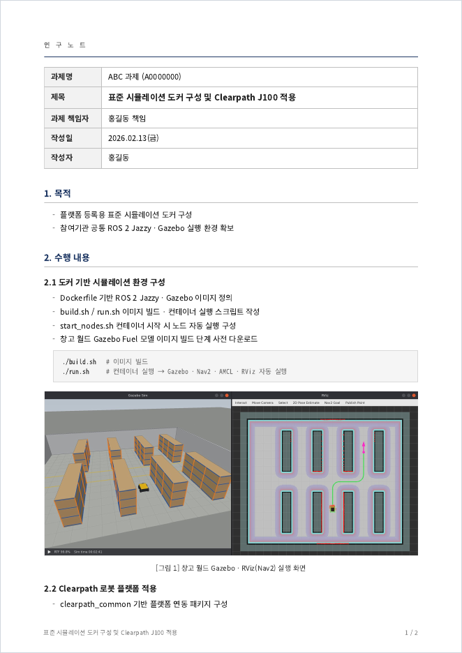

# research-notes

레포지토리 커밋으로 **과제 연구노트**를 만들어 주는 Claude Code · Codex 스킬입니다.

- 노트 작성 기간 동안 한 달에 2건(둘째 · 넷째 금요일, 공휴일이면 직전 평일)
- 노트마다 A4 PDF 1개 (최대 4쪽, 목표 1~2쪽)
- 기관 시스템에 붙여넣을 텍스트: 실험 제목 + 실험내용요약 7줄
- 커밋 날짜와 상관없이, 기간 안의 커밋에서 중요한 것만 골라 노트 개수만큼 주제를 나눔
- 이미 쓴 노트가 있으면 그 칸은 건너뛰고 같은 내용을 반복하지 않음



## 필요한 것

- Claude Code 또는 Codex
- Python 3.10 이상 (추가 패키지 없음. Pillow가 있으면 큰 그림을 줄여서 넣음)
- Chrome, Chromium, Edge 중 하나, 버전 131 이상 (PDF 인쇄용. 그보다 낮으면 쪽 번호 · 꼬리말이 빠짐)
- 한국어 글꼴 (Noto Sans CJK KR, 맑은 고딕, Apple SD Gothic Neo, 나눔고딕 중 하나)
- (Codex) 이미 쓴 PDF 노트를 읽으려면 `pdftotext` (poppler-utils)
- 운영체제: Linux에서 개발 · 확인. macOS · Windows는 브라우저 경로 찾기만 지원하며 확인하지 않음

## 설치

Claude Code:

```bash
git clone https://github.com/Neoplanetz/research-notes-skill.git ~/.claude/skills/research-notes
```

Codex:

```bash
git clone https://github.com/Neoplanetz/research-notes-skill.git ~/.agents/skills/research-notes
```

둘 다 쓸 때는 Codex 위치에 한 번 받고 링크를 겁니다:

```bash
git clone https://github.com/Neoplanetz/research-notes-skill.git ~/.agents/skills/research-notes
mkdir -p ~/.claude/skills && ln -s ~/.agents/skills/research-notes ~/.claude/skills/research-notes
```

설치한 뒤 Claude Code · Codex를 다시 열면 스킬이 잡힙니다.

## 사용

- Claude Code: `/research-notes`
- Codex: `$research-notes`

또는 "이 레포 커밋으로 올해 연구노트 만들어줘"처럼 요청합니다. 진행 순서:

1. 입력 받기: 과제명(과제번호 포함), 과제 약칭(파일명 앞부분), 과제 책임자, 작성자, 노트 작성 기간, 이미 쓴 노트 폴더, 레포(현재 레포 · URL · 로컬 경로 여러 개), 커밋 범위 · 대상. 한 번 입력한 값은 다음 실행 때 선택지로 나옵니다.
2. 작성일 칸 계산 (공휴일 반영, 이미 쓴 노트 반영)
3. 커밋 모으기
4. **계획표 확인**: 작성일 · 제목 · 다룰 내용 · 근거 커밋을 먼저 보여 주고, 확인을 받은 뒤에 씁니다.
5. 노트 작성 → PDF 렌더링 → 검사 (요약 7줄, 4쪽 이하, 권장 길이)
6. 복사용 텍스트 출력

### Codex에서 승인 창

Codex는 명령을 샌드박스 안에서 실행합니다. 샌드박스 안에서는 PDF용 브라우저가 실행되지 않고, 작업 폴더 밖에 쓰거나 네트워크를 쓸 수 없어서 아래 단계에서 승인 창이 뜹니다.

- PDF 만들기 (`render.py`): 항상
- 입력값 저장 (`config.py save`), 커밋 모으기 (`collect.py`), 노트 파일 쓰기: 출력 폴더가 작업 폴더 밖이거나 레포가 URL일 때

승인할 때 같은 명령을 다시 묻지 않게 고르면 다음부터는 묻지 않습니다. 쓰는 폴더를 처음부터 쓰기 허용으로 열면 승인 창이 더 줄어듭니다. 이때 폴더가 없으면 Codex의 모든 명령이 실패하므로 먼저 만듭니다:

```bash
mkdir -p ~/research-notes ~/.config/research-notes ~/.cache/research-notes
codex --add-dir ~/research-notes --add-dir ~/.config/research-notes --add-dir ~/.cache/research-notes
```

## 출력

```
~/research-notes/<과제 약칭>/
  research-notes.json   입력값
  commits.txt           모은 커밋
  plan.md               확인한 계획표
  notes/*.md            노트 원본 (고쳐서 다시 렌더링 가능)
  notes/images/
  pdf/<약칭>_<YYMMDD>_<제목>.pdf
  summary.txt           복사용 텍스트
```

복사용 텍스트 예:

```
[2026.02.13(금)] ABC_260213_표준_시뮬레이션_도커_구성_및_Clearpath_J100_적용.pdf
실험 제목
[ABC] 260213 표준 시뮬레이션 도커 구성 및 Clearpath J100 적용

실험내용요약
- 플랫폼 등록용 표준 시뮬레이션 도커 구성
- ...(7줄)
```

노트 한 건만 고친 뒤 다시 만들기 (`summary.txt`는 폴더의 모든 노트로 다시 만들어지고, 제목이 바뀌면 예전 PDF는 지워짐). Codex에 설치했으면 `~/.claude/skills`를 `~/.agents/skills`로 바꿉니다:

```bash
python3 ~/.claude/skills/research-notes/scripts/render.py ~/research-notes/ABC/notes/<파일>.md \
  --pdf-dir ~/research-notes/ABC/pdf --summary ~/research-notes/ABC/summary.txt
```

## 스크립트

| 파일 | 하는 일 |
|---|---|
| `scripts/slots.py` | 기간 → 작성일 칸 (`--existing`으로 이미 쓴 노트 반영) |
| `scripts/collect.py` | 레포 여러 개의 커밋 모으기 (`--list-authors`, `--author`) |
| `scripts/render.py` | 노트 `.md` → PDF, 검사, `summary.txt` |
| `scripts/config.py` | 입력값 저장 · 프로필 |

## 공휴일 표

`data/kr_holidays.json`에 2024~2030년 한국 공휴일이 들어 있습니다. 범위 밖 연도는 계획표에 "공휴일 확인 필요"로 표시됩니다. 갱신:

```bash
pip install holidays
python3 tools/gen_holidays.py 2024 2035
```

## 테스트

```bash
python3 -m unittest discover -s tests -v
```

브라우저가 없으면 PDF 렌더링 테스트는 건너뜁니다.

## 라이선스

MIT
