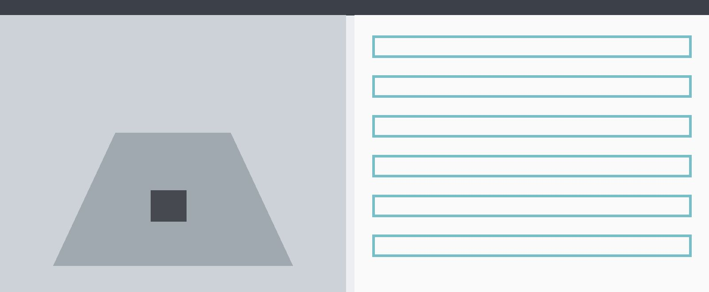

## 1. 목적
- 플랫폼 등록용 표준 시뮬레이션 도커 구성
- 참여기관 공통 ROS 2 Jazzy · Gazebo 실행 환경 확보

## 2. 수행 내용

### 2.1 도커 기반 시뮬레이션 환경 구성
- Dockerfile 기반 ROS 2 Jazzy · Gazebo 이미지 정의
- build.sh / run.sh 이미지 빌드 · 컨테이너 실행 스크립트 작성
- start_nodes.sh 컨테이너 시작 시 노드 자동 실행 구성
- 창고 월드 Gazebo Fuel 모델 이미지 빌드 단계 사전 다운로드

```
./build.sh   # 이미지 빌드
./run.sh     # 컨테이너 실행 → Gazebo · Nav2 · AMCL · RViz 자동 실행
```

### 2.2 Clearpath 로봇 플랫폼 적용
- clearpath_common 기반 플랫폼 연동 패키지 구성
- A200 · A300 · DD100 · DD150 설정 · 실행 파일 추가
- 기본 플랫폼 A200 → J100 변경 (robot.yaml), A200 설정 robot_a200.yaml 유지
- 로봇 namespace robot_a200 → robot_j100 변경

### 2.3 자율주행 스택 구성
- clearpath_nav2_demos 기반 Nav2 · AMCL · RViz 실행
- 사전 작성 점유 격자 지도 /maps 경로 배치
- AMCL 초기 위치 설정 → 시작 직후 위치 추정 안정화
- start_nodes.sh 대기 시간 단축 → 시뮬레이션 시작 시간 감소



## 3. 결과
- run.sh 단일 실행으로 Gazebo · Nav2 · AMCL · RViz 동시 구동 확인
- J100 기준 위치 추정 · 목표 지점 주행 환경 확보
- 참여기관 배포용 시뮬레이션 도커 기본 구조 확정

## 4. 다음 계획
- 기본 서비스(NavigateToPose) · 확장 서비스(NavigateThroughPoses) 도커 분리 구성
- Zenoh 기반 시뮬레이션 · 서비스 컨테이너 간 통신 구성
